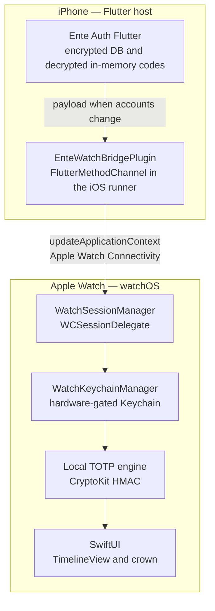

# Architecture

## Topology

Ente Auth on iPhone is Flutter (`mobile/apps/auth`, package `ente_auth` 4.4.27+1007). watchOS needs a pure Swift and SwiftUI target. The watch is an autonomous cryptographic node: it stores eligible seeds and computes RFC 6238 codes on its own clock. A code display does not fetch from the phone over Bluetooth.

**EXTRACTED today:** the phone half exists, without the bridge. `AppDelegate.swift` is a stock `FlutterAppDelegate`. There is no `WCSession`, no `EnteWatchBridgePlugin`, and no watchOS target. A search of the auth app for those names finds nothing to extend. `SUPPORTED_PLATFORMS` on `mobile/apps/auth/ios/Runner.xcodeproj` is `iphonesimulator iphoneos` only.

**INFERRED:** Phase 1 sends the dictionary with `updateApplicationContext` because that API replaces an undelivered dictionary. `transferUserInfo` queues ordered dictionaries and is the wrong default while every message is a full eligible set. Both APIs are real; the choice is documented in [SYNC-CONTRACT.md](SYNC-CONTRACT.md) and [REQUIREMENTS.md](REQUIREMENTS.md) R5.

## What stays where

| Concern | Process | Language |
| :---- | :---- | :---- |
| Vault encryption, online sync, account keys | iPhone Flutter | Dart. `AuthenticatorService`, `AuthenticatorDB`, `Configuration`. Untouched in Phase 1 except a listener outside the crypto path. |
| Payload mapping | iPhone Flutter | Dart pure function `buildWatchPayload`. |
| Method channel and `WCSession` send | iPhone native runner | Swift. New `EnteWatchBridgePlugin`, channel `io.ente.auth/watch`. |
| Keychain, TOTP, UI, complications | Watch extension / watch app | Swift and SwiftUI. Cannot import Flutter. |

Shared packages the auth app already depends on (`ente_crypto_api`, `ente_lock_screen`, `ente_configuration`, `ente_events`, and the rest under `mobile/packages`) stay as they are in Phase 1.

## Process boundaries

1. Flutter isolates decrypt vault rows into `Code` objects in memory. The secret at that point is the base32 string on `Code.secret`.
2. The Dart mapper filters and emits JSON. It does not talk to the watch.
3. The iOS runner's method channel receives the map and hands a property-list dictionary to `WCSession`.
4. watchOS delivers the latest application context to `WatchSessionManager`.
5. `WatchKeychainManager` writes one Keychain item per token id and deletes ids in `deletedIds`.
6. The UI and complications call `TOTPCalculator` against the watch clock.

Seeds cross the boundary as plaintext base32 inside the dictionary. Transport protection is Watch Connectivity's. At-rest protection on the watch is the Keychain access control in R6 and R7. There is no third cipher in Phase 1.

## Data flow

All of these start from a `CodeStore` mutation or an online sync that fires `CodesUpdatedEvent`, then the same mapper.

| Event | Eligible? | Payload effect |
| :---- | :---- | :---- |
| Add a pinned TOTP | Yes, after `generatedID` exists | Upsert in `tokens` |
| Rename issuer or account | Yes if still eligible | Upsert same `id`, new labels |
| Pin | Becomes eligible in the default subset | Upsert |
| Unpin, and no `#watch` tag, `syncAll` false | No | `id` in `deletedIds`, absent from `tokens` |
| Add tag `#watch` | Yes | Upsert, `isFavorite` still reflects `pinned` |
| Trash or delete | No | `deletedIds` |
| Restore from trash | Yes if it matches the subset | Upsert |
| Steam or HOTP add | No (R17) | Omitted. If a previous build had synced it, `deletedIds` |
| Secret edit | Yes if still eligible | Upsert. Watch replaces Keychain bytes for that id |

`id` is the decimal string of `generatedID`. Renames keep the id.

## Failure modes

| Failure | Behavior |
| :---- | :---- |
| Watch unreachable | `updateApplicationContext` may still be called. Apple keeps the latest dictionary and delivers it when the watch is reachable. The UI keeps showing the last Keychain contents. |
| Payload too large | Favorites-first exists so the dictionary stays a short list. Apple's fetched reference does not publish a small fixed byte cap. If the send fails, show a sync error and do not log the dictionary. |
| Passcode missing | R7. Write nothing. Show "Passcode required on Apple Watch to sync tokens". |
| Watch locked / wrist off | Keychain reads fail until unlock. Show a locked state, not a cached code from RAM. |
| Clock wrong on the watch | Codes follow the watch clock (R20). They can disagree with the website until the watch time is corrected. |
| Context replaced mid-flight | The older dictionary is discarded. Because each dictionary is a full eligible set, the survivor is enough. |
| User-info mixed with context | Out of scope for Phase 1. Mixing the two channels can reapply a stale queued dictionary after a newer context. |

## Graphify scope

A graph already exists at `/Volumes/MacExt/ente/graphify-out/` (`GRAPH_REPORT.md`, plus `graph.json` and `graph.html`). Do not rebuild it.

**EXTRACTED from `GRAPH_REPORT.md` (2026-10-09):** the corpus is the auth app area that was graphed, reported as 155 files, about 57,932 words, 1986 nodes, 3026 edges, 42 communities. Extraction mix on that report: 92% EXTRACTED, 7% INFERRED, 1% AMBIGUOUS. The community list includes "Watch Spec And Vault Sync". God nodes, in order: `package:flutter/material.dart`, `package:ente_strings/ente_strings.dart`, `package:logging/logging.dart`, `package:ente_components/ente_components.dart`, then the first domain hub `package:ente_auth/models/code.dart`.

The corpus was scoped to `mobile/apps/auth/lib`, `AppDelegate.swift`, and the architectural spec. The monorepo also contains the photos app, the web app, and the server. The graphify scoping note for that run put those trees at roughly 4048 files under `mobile/`, 1387 under `web/`, and 860 under `server/`. Those counts were not re-measured while writing this folder. Those trees were not mapped. Do not treat graph nodes as evidence about Photos, Locker, or the server.

Surprising connections in the report are semantic similarities, tagged INFERRED, for example:

- "Next Code Preview" similar to `CodeWidget`'s next code
- "Hardware Keychain Isolation" similar to `Configuration`'s `FlutterSecureStorage`
- "Always-On Display Obfuscation" similar to `CodeWidget` masking
- "Shielded Mode Tap-to-Reveal" similar to `PreferenceService.shouldHideCodes`
- "Manual Sorting Mirror" similar to `CodeDisplay.position`

Use those as hints that a phone analogue exists. The phone analogue is not the watch implementation.

The edge `#watch Custom Tag` → `TagChipState` is tagged AMBIGUOUS (`conceptually_related_to`). `TagChipState` is only `selected` or `unselected` (`tag_enums.dart`). It does not mean a `#watch` tag is implemented. See R12 and [DESIGN.md](DESIGN.md).
