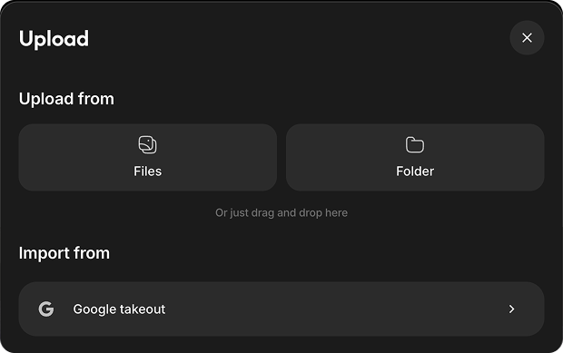
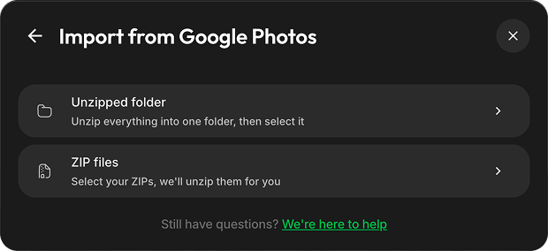
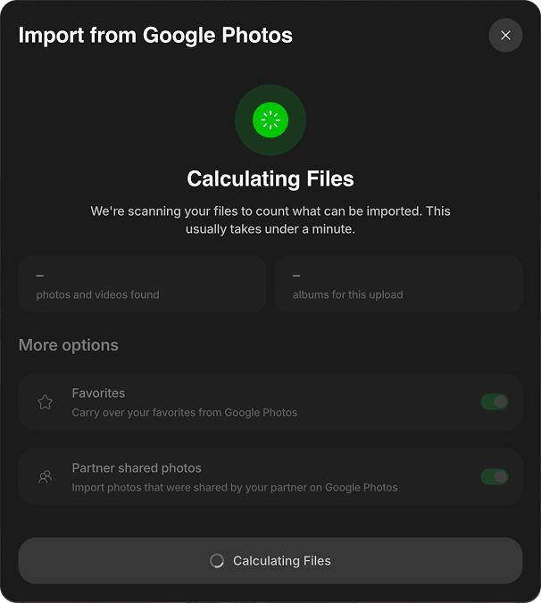
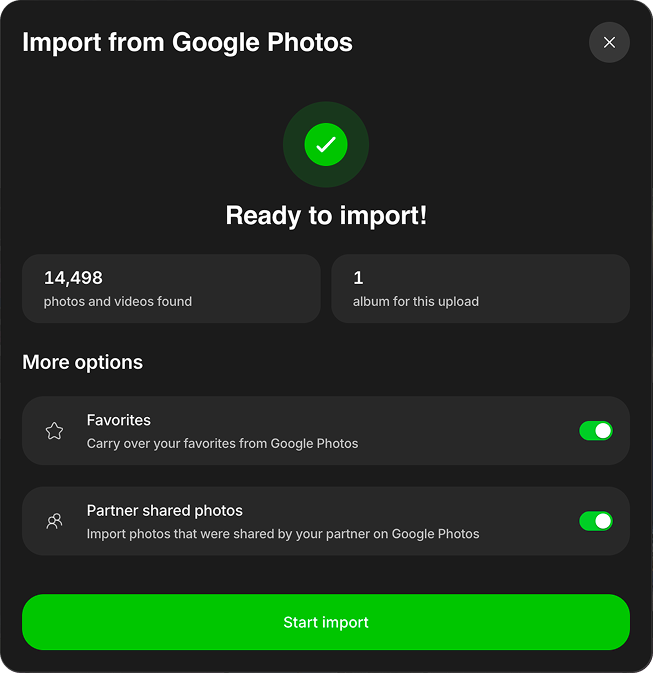
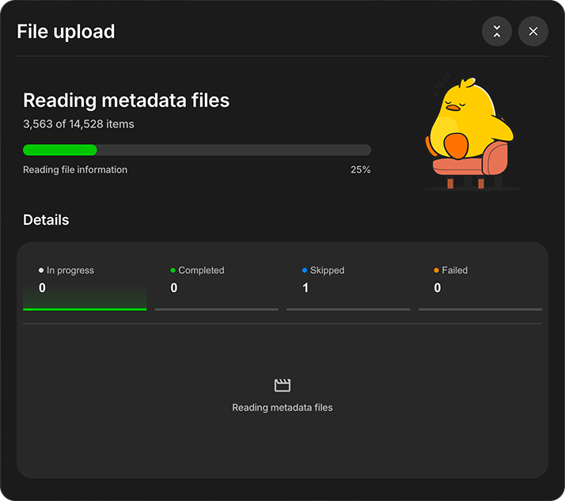

# Import from Google Photos

Google Takeout is how you export a whole Google Photos library. Takeout gives you the original photos and videos, and it stores most of the metadata (dates, locations, and descriptions) in a separate `.json` file next to each photo. Metadata usually goes missing because that JSON file was separated from its photo.

Follow the steps below to export the library and import it into Ente. Ente reads those JSON files, matches them to each photo or video, and encrypts the metadata before upload. Learn more in the [Migration FAQ](/photos/faq/migration).

### Steps

1. Open [takeout.google.com](https://takeout.google.com).

2. Click **Deselect all**. Google selects every service by default, and this export should include only Photos.

    

3. Scroll down to Google Photos and select the checkbox next to it.

    

4. Leave **All photo albums included** as it is to export the whole library. Click it only when you want some albums.

5. If you opened album selection, select the albums to export.

    

6. Scroll down and click **Next step**.

    

7. Choose **Export once**, file type **.zip**, and the largest file size you can handle, then click **Create export**.

    

    Google emails you when the export is ready. A large library can take hours or days, and the export may be split into several ZIP parts.

8. Download **every ZIP part** listed for that export before starting the import.

    A photo and its JSON file can end up in different parts. Importing only some of the parts can give those photos the wrong date.

    A file ending in `.crdownload` is an unfinished Chrome download. It is not a photo or a completed ZIP, and it may represent an archive containing many photos and videos. [Resume the download or download that part again](https://support.google.com/chrome/answer/2898334/fix-file-download-errors?hl=en-GB); changing its filename does not complete it.

    If your computer lacks space, download and extract the Takeout on an external drive with enough free space for the archives and extracted files. Keep the drive connected during import. You still need to download the export from Google and upload the files to Ente.

    Keep the original ZIPs and extracted files until you have reviewed the import, checked important photos and dates, and verified another backup. Learn more about [unfinished or oversized Takeout downloads](/photos/faq/migration#takeout-download-incomplete).

9. Open [the Ente desktop app](https://ente.com/download/), click **Upload**, and select **Google takeout**.

    

10. Choose how to select the Takeout:
    - **Unzipped folder (recommended)**: If you have multiple ZIP files, extract them all into one parent folder first. Keep the subfolders exactly as Takeout made them instead of flattening everything into one folder. Ente uses that folder layout to match each photo or video with its metadata. Each photo should sit next to a `.json` file with a similar name. That file holds its date, location, and description. Learn more about [Google Takeout metadata](/photos/faq/metadata-and-editing#google-takeout-metadata).
    - **ZIP files**: Select the downloaded ZIP files directly and Ente will extract them. If Google split a media file and its metadata across different ZIPs, the metadata might not be matched correctly. The unzipped folder is the safer choice.

    

11. Choose where to import your photos:

    **If you selected a folder**, decide whether you want to:
    - **Import to existing album** → Pick one of your current albums, or
    - **Create new album(s)** → Click "Create albums", then:
        - If your folder has subfolders: Choose between "Separate albums" (each folder becomes its own album) or "Single album" (everything goes into one album)

            

        - If it's a single folder: Just name your new album

    **If you selected ZIP files directly**:
    - Photos are automatically organized into separate albums based on the folder structure within the ZIPs

12. Wait while Ente scans the selected files. The **Calculating Files** screen remains visible while Ente counts importable media and albums.

    

13. Review the import summary:
    - The first total combines the photos and videos found.
    - The second total shows how many albums will be created or updated.
    - **Favorites** is enabled by default. Keep it enabled to add items marked as favorites in Google Photos to Ente's Favorites album.
    - **Partner shared photos** is enabled by default. Disable it when the original owner is also importing their library and you want to avoid duplicate copies. Excluded items appear under **Skipped** with the reason **Shared by partner**.

    

14. Click **Start import**. The upload begins as a compact progress card in the bottom-right corner. Expand it to view the current phase and the **In progress**, **Completed**, **Skipped**, and **Failed** sections.

    

    Ente reads the JSON metadata sidecar files included in the Takeout before uploading the associated photos and videos.

    

    Learn more about stopping an upload, reviewing skipped or failed items, and retrying failures in [Import from Local Hard Disk](/photos/migration/from-local-hard-disk).

Ente reads the Google Takeout metadata it can match with your photos and videos, and encrypts it before upload. Check a sample of imported dates and review failed or skipped items before considering the migration complete.

## Check the import before you delete anything

Keep the Google Photos library until you have checked the copy in Ente.

- Compare what Ente imports with the count in Google Photos. Takeout copies a photo that is in several albums into each album folder, so the number of extracted files is often much larger than Google's library count. Allow for those copies, and for items Ente skips or fails.
- Spot-check old photos, scanned photos, and screenshots. These are the ones most likely to get a wrong date.
- Review anything the import reports as failed or skipped.

Google Photos keeps backed-up photos and videos in Trash for 60 days. Items that were not backed up stay in Trash for 30 days ([Delete photos and videos](https://support.google.com/photos/answer/6128858)). In Ente, deleted items stay in [Trash](/photos/features/albums-and-organization/deleting) for 30 days before they are permanently removed.

## Resume an import or correct imported dates {#resume-or-correct-import}

If an Ente upload is interrupted, select the same source folder or files again. Ente skips matching files already uploaded to the target album and processes the rest. A skipped file keeps its existing metadata; retrying does not retroactively rewrite its date.

Before cleaning up items in Ente, [stop any active import](/photos/migration/from-local-hard-disk#stop-and-resume-an-upload). Items still in the selected source can upload again. If you want to exclude items from a later import, prepare a separate working copy of the source and keep your original export unchanged.

For incorrect dates, follow the [date-repair guidance](/photos/faq/metadata-and-editing#google-photos-dates-wrong). Keep your Takeout ZIPs, extracted originals, and matching JSON files until you have checked the imported library and verified another backup.

## Optional: write the JSON metadata into the files

This step is not required for an Ente import. Ente reads the JSON sidecars during import.

To write those values into the photo files themselves, people commonly use [ExifTool](https://exiftool.org/) or community tools built on it. Test on a copy of a few hundred photos and check the dates before running it on the whole export.

## FAQs

### Why are my photo dates all set to the day I downloaded them? {#takeout-dates-set-to-download-day}

The date is in the JSON file, not in the photo. Import with Ente's **Google takeout** option, which reads that JSON, or write the JSON into the files as described above. Learn more in [Resume an import or correct imported dates](#resume-or-correct-import).

### Does Takeout keep my albums? {#takeout-albums-become-folders}

Albums come out as folders. A photo that is in several albums is copied into each album folder, so the export is often much larger than the library. Ente detects those copies on import and stores one original. Learn more in the [Migration FAQ](/photos/faq/migration#google-takeout-storage).

### What about Live Photos and motion photos? {#takeout-live-photos-and-motion-photos}

How they come out of Takeout, and whether they are paired again, depends on the photo and on the import. Spot-check a few after importing.

### Do I lose quality? {#takeout-stored-file-quality}

Takeout exports the stored files. If you backed up with Storage saver, Google only kept a compressed copy: photos over 16 MP are resized to 16 MP, and videos above 1080p are resized to 1080p ([Storage saver](https://support.google.com/photos/answer/6220791)). That is what Takeout gives you.

### Can I download everything from photos.google.com? {#download-some-albums-from-google-photos}

For a handful of albums, yes. For a whole library, Takeout is the practical route. Google does not offer a download-everything button.

If you run into any issues during this migration, please check out our [Migration FAQ](/photos/faq/migration#importing-from-google-photos) page or reach out to [support@ente.com](mailto:support@ente.com) and we will be happy to help you!

> [!TIP]
>
> In case you wish to use face recognition and other advanced search features provided by Ente, we recommend that you enable [machine learning](/photos/features/search-and-discovery/machine-learning) before importing your photos so that the Ente app can directly index files as they are getting uploaded.
